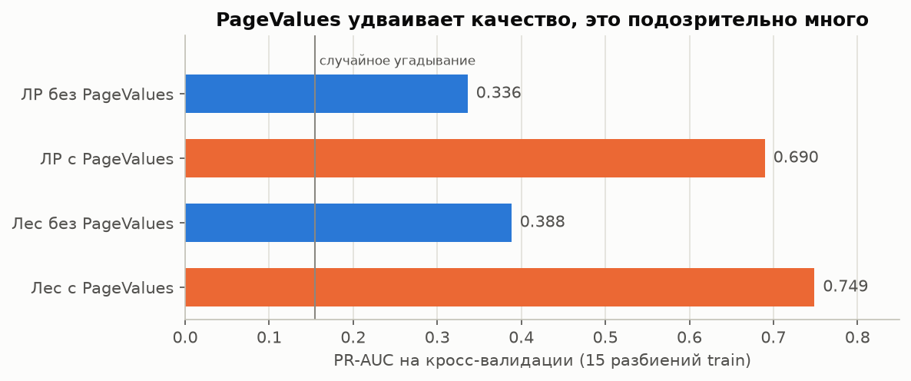
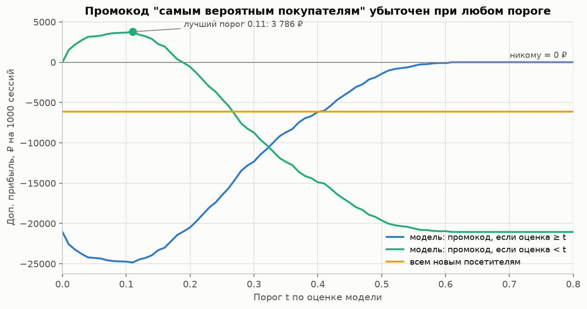

# Поведение покупателей интернет-магазина и предсказание конверсии

**Задача.** По поведению посетителя за один визит (сколько страниц посмотрел, сколько времени провёл, откуда пришёл) понять, что связано с покупкой, и научиться её предсказывать. Затем проверить, выгодно ли использовать такую модель, чтобы решать, кому показывать промокод.

Pet-проект по классическому ML: EDA → проверка гипотез → признаки → модели → анализ ошибок → бизнес-симуляция. Все числа ниже получены кодом в ноутбуках.

## Данные

[UCI Online Shoppers Purchasing Intention Dataset](https://doi.org/10.24432/C5F88Q) (Sakar & Kastro, 2018, CC BY 4.0). **12 330 сессий** одного интернет-магазина за год, каждая сессия от отдельного пользователя. **15.5%** сессий заканчиваются покупкой. Признаки: число страниц трёх типов и время на них, метрики Google Analytics (показатели отказов и выхода, `PageValues`), месяц, тип посетителя, источник трафика и др.

Чего в данных нет: сумм заказов, событий корзины, ID пользователей, порядка действий внутри визита. Поэтому прибыль считается на допущениях, а "брошенные корзины" можно описать только по поведению.

Разбиение train/test (80/20, стратифицированное) сделано в первом ноутбуке. EDA, тесты, признаки и подбор моделей делались только на train, тест использован один раз в конце ноутбука 05.

## Главные результаты

1. **Самый сильный признак оказался утечкой.** Один только `PageValues` даёт ROC-AUC 0.867, а с ним PR-AUC случайного леса вырастает с 0.388 до 0.749. По определению GA он считается из выручки покупок и в момент выдачи промокода недоступен, поэтому **основная модель построена без него**.
2. **Лучшая честная модель: подобранный случайный лес.** PR-AUC **0.387** на кросс-валидации и **0.356** на тесте (95% бутстрэп-интервал 0.313-0.411; у случайного угадывания 0.155), ROC-AUC 0.786 и 0.764. Логистическую регрессию лес обгоняет на 0.035 PR-AUC на тесте (интервал разницы 0.010-0.061). Градиентный бустинг не лучше.
3. **Время на товарных страницах связано с покупкой, но нелинейно.** У купивших медиана на 10 минут больше. Вероятность, что случайный покупатель провёл на товарных страницах больше времени, чем случайный не купивший, равна 0.675 (U-критерий Манна-Уитни, p ≈ 10⁻¹⁰⁵). Конверсия растёт с 2.8% у самых коротких визитов до примерно 20% у визитов длиной 10-14 минут, дальше медленно (28.9% у визитов длиннее 48 минут). Это связь, а не доказанная причина.
4. **"Почти-покупатели" составляют 17% визитов.** Это ложноположительные срабатывания модели: по поведению они почти неотличимы от покупателей (33 против 35 товарных страниц, 21.5 против 23.8 минуты), 40% таких визитов приходятся на ноябрь. Резко отличаются они только по `PageValues` (больше нуля у 23% против 85%), то есть по признаку, который "знает" о покупке.
5. **Промокод "самым вероятным покупателям" убыточен.** При базовых допущениях (маржа 30%, скидка 10%, промокод "дожимает" 5% ушедших) на тесте: -16 111 ₽ на 1000 сессий при пороге 0.224 и -6 717 ₽ при стратегии "всем новым". Модель отдаёт скидку тем, кто купил бы и так. Полезнее обратное: *исключать* уверенных покупателей. Стратегия "оценка < 0.11" даёт +2 910 ₽ на 1000 сессий, но этот плюс держится на спорном допущении. Вывод переворачивается, если промокод "дожимает" больше 15.5% ушедших (или 6.5% при скидке 5%).





## Что подтвердилось, а что нет

| Ожидание в начале проекта | Результат |
|---|---|
| Время на страницах товаров влияет на вероятность покупки | **Частично.** Связь значимая и заметная (вероятность превосходства 0.675), но нелинейная, а причинность не установлена: долгий визит может быть следствием намерения купить |
| Вернувшиеся посетители покупают чаще новых | **Нет, наоборот:** новые 24.7%, вернувшиеся 14.0% (+10.7 п.п., значимо, держится почти в каждом месяце) |
| Перед праздниками покупают чаще | **Нет, наоборот:** рядом с праздником в мае конверсия 6.2% против 13.3% |
| Новые поведенческие признаки улучшат модель | **Нет.** Лучший из 6 признаков дал +0.0009 PR-AUC. Регрессия с логарифмом и лес извлекают ту же информацию из исходных признаков |
| Random Forest лучше логистической регрессии | **Да, но умеренно:** +0.045 PR-AUC на CV, +0.035 на тесте |
| Подбор гиперпараметров улучшит модель | **Для леса да** (+0.020 PR-AUC: не давать деревьям листья из одной сессии), **для регрессии почти нет** (+0.003) |
| Высокое качество модели (ROC-AUC около 0.9) | **Только с утечкой.** Без `PageValues` честный ROC-AUC 0.76-0.79 |
| Можно выделить сегмент "брошенных корзин" / "почти-покупателей" | **Да, как "почти-покупателей":** 1702 сессии в train, профиль устойчив на тесте. "Брошенными корзинами" назвать нельзя: событий корзины в данных нет |
| Промокод по модели выгоднее промокода всем новым | **Нет.** При базовых допущениях хуже при любом пороге. Модель полезна, чтобы *не* давать промокод уверенным покупателям |

## Ограничения

- **Один магазин, один год, 12 тысяч сессий.** Без расшифровки источников трафика, браузеров и регионов.
- **Признаки посчитаны по всему визиту.** В реальности решение о промокоде принимается раньше, на неполной сессии, и модель будет слабее.
- **Показатели отказов и выхода тоже метрики GA за весь период.** Утечки выручки в них нет, но в продакшене их надо считать только по прошлым данным.
- **Длительности занижены:** GA не записывает время последней страницы (у 720 сессий длительность 0).
- **Деньги посчитаны на допущениях.** Особенно "сила" промокода и то, на кого он действует. Вероятность покупки без промокода не то же самое, что эффект от промокода (uplift).
- **Тест хуже кросс-валидации** (0.356 против 0.387 PR-AUC), разница в пределах статистической погрешности, но это напоминание, что цифры с CV немного оптимистичны.

## Что можно улучшить

- Провести A/B-тест промокода со стратификацией по оценке модели (дизайн и размеры выборки есть в ноутбуке 07) и обучить на его данных uplift-модель.
- Честный аналог `PageValues`: ценность страниц по прошлым периодам, без текущей сессии.
- Модель на неполных сессиях (первые N страниц), она ближе к реальному сценарию.
- Проверить сегмент "почти-покупателей" на данных с событиями корзины и ID пользователей (например, Kaggle REES46).

## Как запустить

Нужен Python 3.12. Склонируйте репозиторий и перейдите в его папку. Данные уже лежат в `data/raw/`. Если файла нет, `src/data.py` скачает его с UCI.

```bash
python -m venv .venv
```

```bash
.venv\Scripts\activate
```

(на Linux/macOS: `source .venv/bin/activate`)

```bash
pip install -r requirements.txt
```

Ноутбуки запускаются строго по порядку 01 → 07: каждый следующий использует файлы, которые сохранил предыдущий (`data/processed/`, `models/`). Можно открыть их в Jupyter и выполнить Restart & Run All по очереди, либо выполнить все из командной строки (около 6 минут, дольше всего подбор гиперпараметров в 05):

```bash
for nb in notebooks/0*.ipynb; do jupyter nbconvert --to notebook --execute --inplace "$nb"; done
```

В PowerShell то же самое:

```powershell
Get-ChildItem notebooks\0*.ipynb | ForEach-Object { jupyter nbconvert --to notebook --execute --inplace $_.FullName }
```

Все случайности зафиксированы (`random_state=42`). Повторный запуск с нуля даёт те же числа.

Если нужно только посмотреть анализ ошибок и бизнес-симуляцию, ноутбуки 06 и 07 можно запускать сразу: нужные им предсказания модели уже лежат в `data/processed/`. Сам файл модели (`models/final_model.joblib`, около 13 МБ) в репозитории не хранится, его создаёт ноутбук 05.

## Навигация по ноутбукам

| Ноутбук | Вопрос | Главное |
|---|---|---|
| [01_data_overview](notebooks/01_data_overview.ipynb) | Что за данные и можно ли им доверять? | Описание колонок, пропуски, дубликаты, дисбаланс, разбиение train/test |
| [02_eda](notebooks/02_eda.ipynb) | От чего зависит конверсия? | Сезонность, тип посетителя, праздники, источники трафика, время на товарах; 7 гипотез |
| [03_hypothesis_testing](notebooks/03_hypothesis_testing.ipynb) | Какие различия не случайны и насколько они велики? | 6 тестов (Манн-Уитни, хи-квадрат), размеры эффекта, поправка Холма, значимость ≠ причинность |
| [04_feature_engineering](notebooks/04_feature_engineering.ipynb) | На каких признаках учить модель? | Утечка через `PageValues`, логарифм, новые признаки (не помогли) |
| [05_modeling](notebooks/05_modeling.ipynb) | Какая модель лучше? | Dummy → регрессия → лес → бустинг, подбор гиперпараметров, дисбаланс и порог, permutation importance, финальный тест |
| [06_error_analysis](notebooks/06_error_analysis.ipynb) | Где модель ошибается? | Матрица ошибок, сегмент "почти-покупателей", идеи для бизнеса, ограничения |
| [07_business_simulation](notebooks/07_business_simulation.ipynb) | Выгоден ли промокод по модели? | Стратегии, прибыль по порогу, чувствительность к допущениям, дизайн A/B-теста |

Все эксперименты, включая неудачные, записаны в [reports/experiments_log.md](reports/experiments_log.md).

## Структура репозитория

```
ecommerce-conversion/
├── README.md
├── requirements.txt
├── .gitignore
├── data/
│   ├── raw/                  # исходный CSV с UCI, не редактируется
│   └── processed/            # train/test (ноутбук 01) и предсказания модели (ноутбук 05)
├── notebooks/                # 01-07, сохранены с выводами
├── src/
│   ├── config.py             # пути, random_state, списки колонок
│   ├── data.py               # загрузка, очистка, разбиение
│   ├── features.py           # новые признаки, препроцессинг, итоговый набор признаков
│   ├── evaluation.py         # кросс-валидация, метрики, пороги, permutation importance
│   ├── stats_tests.py        # конверсия с интервалами, размеры эффекта
│   ├── business.py           # модель прибыли промокода
│   ├── experiments.py        # журнал экспериментов
│   └── plots.py              # стиль графиков
├── models/                   # параметры финальной модели; сам .joblib создаётся в 05 и в git не хранится
└── reports/
    ├── figures/              # ключевые графики
    ├── experiments.csv       # журнал экспериментов (данные)
    └── experiments_log.md    # журнал экспериментов (таблица)
```
